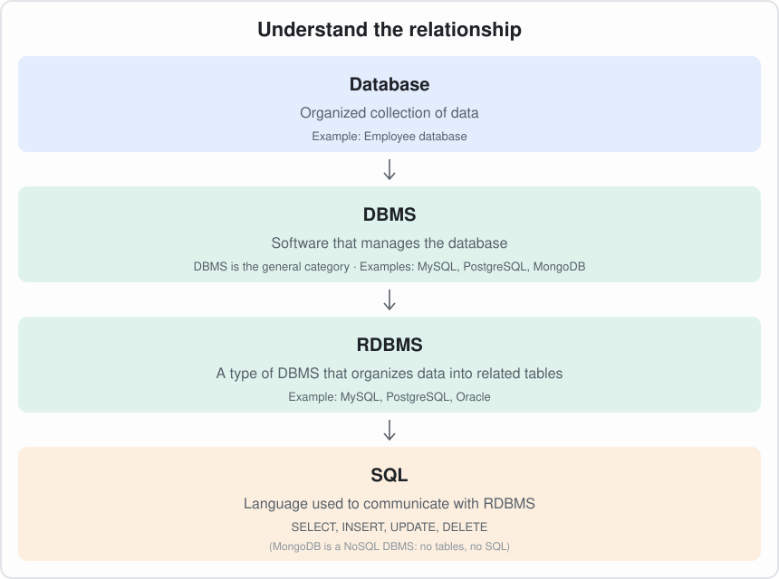

# SQL – Interview Notes

<p align="center">
  
</p>

## The Big Picture

| Term | Meaning | Examples |
|------|---------|----------|
| **Database** | A place / organized collection where data is stored | Employee database |
| **DBMS** | Software used to create, access, update, delete and manage databases | MySQL, PostgreSQL, Oracle, MongoDB |
| **RDBMS** | A type of DBMS that stores data in **tables** and establishes **relationships** between them | MySQL, PostgreSQL, Oracle |
| **SQL** | A **language** used to interact with relational databases | `SELECT`, `INSERT`, `UPDATE`, `DELETE` |
| **NoSQL DBMS** | A DBMS that does **not** use tables (documents, key-value, graph…) | MongoDB |

> **Interview tip:** Every RDBMS is a DBMS, but not every DBMS is an RDBMS (MongoDB is a DBMS, not an RDBMS).
> MySQL, PostgreSQL and Oracle are **software**; SQL is the **language** they understand.

---

## 1. What is a Database?

A **database** is an organized collection of data that can be easily stored, accessed, managed and updated.
A **DBMS (Database Management System)** is the software used to manage it (e.g. MySQL, PostgreSQL, Oracle, SQL Server, MongoDB).

---

## 2. What is SQL?

**SQL (Structured Query Language)** is the standard language used to communicate with **relational databases**.
It is used to create, read, update and delete data (CRUD), and to define and control the database structure.

- Pronounced "S-Q-L" or "sequel"
- It is **declarative** – you say *what* you want, not *how* to get it
- Keywords are **not case-sensitive** (`SELECT` = `select`), but writing them in UPPERCASE is the convention

> **Interview tip:** SQL is a *language*. MySQL / PostgreSQL / Oracle are *database systems* (RDBMS) that use SQL.

---

## 3. Relational vs Non-Relational Databases

### Relational Database (RDBMS)
- Data is stored in **tables** (rows and columns)
- Tables are linked using **keys** (primary key / foreign key)
- Has a **fixed schema** (structure defined before inserting data)
- Uses **SQL**
- Follows **ACID** properties
- Scales **vertically** (bigger server)
- Examples: **MySQL, PostgreSQL, Oracle, SQL Server, SQLite**

### Non-Relational Database (NoSQL)
- Data is stored in formats other than tables
- **Flexible / dynamic schema**
- Scales **horizontally** (add more servers)
- Good for big data, real-time apps, unstructured data
- Usually follows **BASE** (Basically Available, Soft state, Eventually consistent)

| Type of NoSQL      | How data is stored          | Example            |
|--------------------|-----------------------------|--------------------|
| Document           | JSON-like documents         | MongoDB, CouchDB   |
| Key-Value          | Key → value pairs           | Redis, DynamoDB    |
| Column-Family      | Columns grouped in families | Cassandra, HBase   |
| Graph              | Nodes and edges             | Neo4j              |

### SQL vs NoSQL – Quick Comparison

| Feature        | SQL (Relational)             | NoSQL (Non-Relational)          |
|----------------|------------------------------|---------------------------------|
| Structure      | Tables (rows & columns)      | Document, key-value, graph, column |
| Schema         | Fixed / predefined           | Flexible / dynamic              |
| Scaling        | Vertical                     | Horizontal                      |
| Transactions   | ACID                         | BASE (mostly)                   |
| Joins          | Supported                    | Generally not / limited         |
| Best for       | Complex queries, banking, ERP| Big data, real-time, social apps|
| Examples       | MySQL, PostgreSQL, Oracle    | MongoDB, Redis, Cassandra       |

> **Interview tip:** Choose SQL when data is structured and consistency matters (e.g. banking). Choose NoSQL when data is unstructured, changes often, or needs massive scale.

### SQL vs NoSQL – Same Idea, Different Names

NoSQL terms below use **MongoDB**, the most common NoSQL database in interviews.

| SQL (MySQL, PostgreSQL) | NoSQL (MongoDB) | Meaning |
|-------------------------|-----------------|---------|
| **Database** | **Database** | A container that holds all your data |
| **Table** | **Collection** | A group of similar records (e.g. all employees) |
| **Row** (record / tuple) | **Document** | One record, e.g. one employee |
| **Column** (attribute) | **Field** | One piece of information, e.g. `salary` |
| **Schema** (fixed, defined first) | **Schema-less / flexible schema** | SQL: every row must follow the table's columns. MongoDB: each document can have different fields |
| **Primary key** | **`_id`** | Unique id of each record. MongoDB adds `_id` automatically |
| **Foreign key** | **Reference** (store another document's `_id`) | Link to a record in another table / collection |
| **JOIN** | **Embedding** or **`$lookup`** | Combine related data. MongoDB usually keeps related data inside one document instead |
| **Index** | **Index** | Makes searching faster (same idea in both) |
| **View** | **View** | A saved, read-only query result |
| **SQL query** (`SELECT`) | **Query / find()** (`db.employees.find()`) | How you read data |
| **GROUP BY** | **Aggregation pipeline** (`$group`) | Group and summarise data |
| **Transaction (ACID)** | **Transaction** (supported, but used less) | Several changes that succeed or fail together |
| **Server / instance** | **Server (`mongod`)** | One running database program |
| **Replication** (primary + replicas) | **Replica set** | Copies of the same data on several servers, so it keeps working if one fails |
| **Partitioning / sharding** | **Sharding** (a **shard** = one part of the data) | Splitting a huge dataset across many servers |
| **Cluster** | **Cluster** | A group of servers working together as one database (a replica set or a sharded cluster). In MongoDB Atlas, the cloud database you create is called a cluster |

### Same Employee, Two Ways

**SQL:** a row in the `employees` table. The department is in another table, linked by `dept_id`:

| emp_id | name | salary | dept_id |
|--------|------|--------|---------|
| 1 | Rahul Sharma | 90000 | 20 |

```sql
SELECT e.name, d.dept_name
FROM employees e
JOIN departments d ON e.dept_id = d.dept_id
WHERE e.emp_id = 1;
```

**MongoDB:** a document in the `employees` collection. Related data can sit inside it (embedded), so no JOIN is needed:

```json
{
  "_id": 1,
  "name": "Rahul Sharma",
  "salary": 90000,
  "department": { "name": "IT", "location": "Pune" },
  "skills": ["SQL", "Python"]
}
```

```js
db.employees.find({ _id: 1 }, { name: 1, "department.name": 1 })
```

> Notice: `skills` is a list inside the document. In SQL this would need a separate `employee_skills` table.

### Quick Memory Trick

```
SQL:     Database → Table      → Row      → Column
MongoDB: Database → Collection → Document → Field
```

> **Interview tip:** "Schema-less" does not mean "no structure". It means the database does not **force** one structure. Each document can look different, and your app decides the shape.

---

## 4. Types of SQL Commands

```
SQL Commands
├── DDL  – Data Definition Language     → structure
├── DML  – Data Manipulation Language   → data
├── DQL  – Data Query Language          → reading data
├── DCL  – Data Control Language        → permissions
└── TCL  – Transaction Control Language → transactions
```

### 4.1 DDL – Data Definition Language
Defines / changes the **structure** (schema) of the database. Changes are **auto-committed** (cannot be rolled back in most databases).

| Command    | Use                                  |
|------------|--------------------------------------|
| `CREATE`   | Create database / table / view / index |
| `ALTER`    | Modify an existing table             |
| `DROP`     | Delete the whole table (structure + data) |
| `TRUNCATE` | Delete all rows, keep the structure  |
| `RENAME`   | Rename a table                       |

```sql
CREATE TABLE employees (
    id         INT PRIMARY KEY,
    name       VARCHAR(50) NOT NULL,
    salary     DECIMAL(10,2),
    dept_id    INT
);

ALTER TABLE employees ADD email VARCHAR(100);
ALTER TABLE employees DROP COLUMN email;

TRUNCATE TABLE employees;
DROP TABLE employees;
```

### 4.2 DML – Data Manipulation Language
Works with the **data inside** tables. Can be rolled back (inside a transaction).

| Command  | Use                 |
|----------|---------------------|
| `INSERT` | Add new rows        |
| `UPDATE` | Modify existing rows|
| `DELETE` | Remove rows         |

```sql
INSERT INTO employees (id, name, salary, dept_id) VALUES (1, 'Aniket', 50000, 10);

UPDATE employees SET salary = 60000 WHERE id = 1;

DELETE FROM employees WHERE id = 1;
```

> ⚠️ Always use `WHERE` with `UPDATE` / `DELETE`, otherwise **all rows** are affected.

### 4.3 DQL – Data Query Language
Used to **fetch** data.

```sql
SELECT name, salary FROM employees WHERE salary > 40000;
```

> Some people put `SELECT` under DML. Both answers are accepted – just mention DQL exists.

### 4.4 DCL – Data Control Language
Controls **access / permissions**.

```sql
GRANT SELECT, INSERT ON employees TO user1;
REVOKE INSERT ON employees FROM user1;
```

### 4.5 TCL – Transaction Control Language
Manages **transactions** (a group of operations treated as one unit).

| Command     | Use                                   |
|-------------|---------------------------------------|
| `COMMIT`    | Save changes permanently              |
| `ROLLBACK`  | Undo changes since last commit        |
| `SAVEPOINT` | Create a point to roll back to        |

```sql
START TRANSACTION;
UPDATE accounts SET balance = balance - 500 WHERE id = 1;
UPDATE accounts SET balance = balance + 500 WHERE id = 2;
COMMIT;   -- or ROLLBACK;
```

---

## 5. DELETE vs TRUNCATE vs DROP (Very Common Question)

| Feature            | DELETE            | TRUNCATE              | DROP                    |
|--------------------|-------------------|-----------------------|-------------------------|
| Type               | DML               | DDL                   | DDL                     |
| Removes            | Selected / all rows | All rows            | Entire table            |
| `WHERE` allowed    | Yes               | No                    | No                      |
| Rollback possible  | Yes               | No (mostly)           | No                      |
| Structure kept     | Yes               | Yes                   | No                      |
| Speed              | Slower (row by row)| Faster               | Fastest                 |
| Resets identity    | No                | Yes                   | –                       |

---

## 6. ACID Properties

| Property        | Meaning                                                      |
|-----------------|--------------------------------------------------------------|
| **Atomicity**   | All or nothing – the whole transaction succeeds or fails      |
| **Consistency** | Database moves from one valid state to another               |
| **Isolation**   | Concurrent transactions don't affect each other              |
| **Durability**  | Once committed, data is saved even if the system crashes      |

Example: Money transfer – debit and credit must both happen, or neither.

---

## 7. Keys

| Key              | Description                                                         |
|------------------|---------------------------------------------------------------------|
| **Primary Key**  | Uniquely identifies each row. **Unique + NOT NULL**. Only one per table |
| **Foreign Key**  | Column that refers to the primary key of another table (creates relationship) |
| **Unique Key**   | Values must be unique, but **allows one NULL** (in most DBs). Can have many |
| **Candidate Key**| All columns that could be a primary key                             |
| **Composite Key**| Primary key made of 2+ columns                                      |
| **Super Key**    | Any set of columns that uniquely identifies a row                   |
| **Alternate Key**| Candidate keys not chosen as primary key                            |

```sql
CREATE TABLE departments (
    dept_id   INT PRIMARY KEY,
    dept_name VARCHAR(50) UNIQUE
);

CREATE TABLE employees (
    id      INT PRIMARY KEY,
    name    VARCHAR(50),
    dept_id INT,
    FOREIGN KEY (dept_id) REFERENCES departments(dept_id)
);
```

**Primary Key vs Unique Key:** Primary key → no NULLs, only one per table. Unique key → allows NULL, many per table.

---

## 8. Constraints

Rules applied on columns:

- `NOT NULL` – value cannot be empty
- `UNIQUE` – all values different
- `PRIMARY KEY` – NOT NULL + UNIQUE
- `FOREIGN KEY` – links to another table
- `CHECK` – value must meet a condition (`CHECK (age >= 18)`)
- `DEFAULT` – default value if none given (`DEFAULT 'India'`)

---

## 9. Most Common SQL Things You Must Know

### 9.1 SELECT basics
```sql
SELECT * FROM employees;                          -- all columns
SELECT DISTINCT dept_id FROM employees;           -- unique values
SELECT name AS employee_name FROM employees;      -- alias
SELECT * FROM employees LIMIT 5;                  -- first 5 rows (MySQL/PostgreSQL)
SELECT TOP 5 * FROM employees;                    -- SQL Server
```

### 9.2 WHERE & Operators
```sql
SELECT * FROM employees WHERE salary > 50000 AND dept_id = 10;
SELECT * FROM employees WHERE dept_id IN (10, 20, 30);
SELECT * FROM employees WHERE salary BETWEEN 30000 AND 60000;
SELECT * FROM employees WHERE name LIKE 'A%';     -- starts with A
SELECT * FROM employees WHERE name LIKE '%n';     -- ends with n
SELECT * FROM employees WHERE name LIKE '_n%';    -- 2nd letter is n
SELECT * FROM employees WHERE email IS NULL;      -- never use = NULL
```
- `%` → any number of characters, `_` → exactly one character

### 9.3 ORDER BY
```sql
SELECT * FROM employees ORDER BY salary DESC, name ASC;
```

### 9.4 Aggregate Functions
`COUNT()`, `SUM()`, `AVG()`, `MIN()`, `MAX()`
```sql
SELECT COUNT(*), AVG(salary), MAX(salary) FROM employees;
```
- `COUNT(*)` counts all rows; `COUNT(column)` ignores NULLs.

### 9.5 GROUP BY & HAVING
```sql
SELECT dept_id, COUNT(*) AS total, AVG(salary) AS avg_sal
FROM employees
GROUP BY dept_id
HAVING COUNT(*) > 2;
```

**WHERE vs HAVING**

| WHERE                          | HAVING                         |
|--------------------------------|--------------------------------|
| Filters rows **before** grouping | Filters groups **after** grouping |
| Cannot use aggregate functions | Can use aggregate functions    |

### 9.6 Order of Execution (Very Important)
Written order:
```
SELECT → FROM → WHERE → GROUP BY → HAVING → ORDER BY → LIMIT
```
Actual execution order:
```
FROM → JOIN → WHERE → GROUP BY → HAVING → SELECT → DISTINCT → ORDER BY → LIMIT
```
That's why you can't use a `SELECT` alias inside `WHERE`.

### 9.7 JOINS
```sql
-- INNER JOIN: only matching rows in both tables
SELECT e.name, d.dept_name
FROM employees e
INNER JOIN departments d ON e.dept_id = d.dept_id;

-- LEFT JOIN: all rows from left + matching from right (else NULL)
SELECT e.name, d.dept_name
FROM employees e
LEFT JOIN departments d ON e.dept_id = d.dept_id;

-- RIGHT JOIN: all rows from right + matching from left
-- FULL OUTER JOIN: all rows from both sides
-- CROSS JOIN: every combination (Cartesian product)
-- SELF JOIN: table joined with itself
SELECT e.name AS employee, m.name AS manager
FROM employees e
JOIN employees m ON e.manager_id = m.id;
```

| Join            | Returns                                      |
|-----------------|----------------------------------------------|
| INNER JOIN      | Only matching rows                           |
| LEFT JOIN       | All left + matching right                    |
| RIGHT JOIN      | All right + matching left                    |
| FULL OUTER JOIN | All rows from both                           |
| CROSS JOIN      | Every row × every row                        |
| SELF JOIN       | Table joined with itself                     |

### 9.8 Subqueries
```sql
-- Employees earning more than the average
SELECT name, salary FROM employees
WHERE salary > (SELECT AVG(salary) FROM employees);
```

### 9.9 UNION vs UNION ALL
- `UNION` → combines results and **removes duplicates**
- `UNION ALL` → combines results and **keeps duplicates** (faster)

```sql
SELECT name FROM employees
UNION
SELECT name FROM contractors;
```

### 9.10 CASE (if-else in SQL)
```sql
SELECT name,
       CASE
           WHEN salary > 70000 THEN 'High'
           WHEN salary > 40000 THEN 'Medium'
           ELSE 'Low'
       END AS salary_level
FROM employees;
```

### 9.11 Window Functions
```sql
SELECT name, dept_id, salary,
       ROW_NUMBER() OVER (PARTITION BY dept_id ORDER BY salary DESC) AS row_num,
       RANK()       OVER (PARTITION BY dept_id ORDER BY salary DESC) AS rnk,
       DENSE_RANK() OVER (PARTITION BY dept_id ORDER BY salary DESC) AS dense_rnk
FROM employees;
```
For salaries 100, 90, 90, 80:

| Salary | ROW_NUMBER | RANK | DENSE_RANK |
|--------|------------|------|------------|
| 100    | 1          | 1    | 1          |
| 90     | 2          | 2    | 2          |
| 90     | 3          | 2    | 2          |
| 80     | 4          | 4    | 3          |

### 9.12 Views
A **view** is a virtual table based on a query (stores no data itself).
```sql
CREATE VIEW high_earners AS
SELECT name, salary FROM employees WHERE salary > 70000;

SELECT * FROM high_earners;
```

### 9.13 Indexes
An **index** speeds up searching (like a book index) but slows down INSERT/UPDATE/DELETE and uses extra space.
```sql
CREATE INDEX idx_name ON employees(name);
```
- **Clustered index** → sorts the actual table data (only one per table, usually the primary key)
- **Non-clustered index** → separate structure pointing to rows (many allowed)

### 9.14 Common String / Date Functions
```sql
UPPER(name), LOWER(name), LENGTH(name), CONCAT(first, ' ', last),
SUBSTRING(name, 1, 3), TRIM(name), REPLACE(name, 'a', 'b')

NOW(), CURRENT_DATE, YEAR(join_date), MONTH(join_date), DATEDIFF(d1, d2)

COALESCE(email, 'N/A')    -- first non-NULL value
```

---

## 10. Normalization

Process of organizing data to **reduce redundancy** and **improve integrity**.

| Form    | Rule                                                                 |
|---------|----------------------------------------------------------------------|
| **1NF** | Each column has atomic (single) values; no repeating groups          |
| **2NF** | 1NF + no partial dependency (non-key column depends on the whole PK) |
| **3NF** | 2NF + no transitive dependency (non-key depends only on the PK)      |
| **BCNF**| Stricter 3NF – every determinant is a candidate key                 |

**Denormalization** = intentionally adding redundancy to make reads faster.

---

## 11. Classic Interview Queries

```sql
-- 1. Second highest salary
SELECT MAX(salary) FROM employees
WHERE salary < (SELECT MAX(salary) FROM employees);

-- 2. Nth highest salary (e.g. 3rd)
SELECT DISTINCT salary FROM employees
ORDER BY salary DESC
LIMIT 1 OFFSET 2;

-- Using DENSE_RANK
SELECT salary FROM (
    SELECT salary, DENSE_RANK() OVER (ORDER BY salary DESC) AS rnk
    FROM employees
) t WHERE rnk = 3;

-- 3. Find duplicate records
SELECT name, COUNT(*) FROM employees
GROUP BY name
HAVING COUNT(*) > 1;

-- 4. Highest salary in each department
SELECT dept_id, MAX(salary) FROM employees GROUP BY dept_id;

-- 5. Employees with no department
SELECT e.name FROM employees e
LEFT JOIN departments d ON e.dept_id = d.dept_id
WHERE d.dept_id IS NULL;

-- 6. Count employees per department
SELECT d.dept_name, COUNT(e.id) AS total
FROM departments d
LEFT JOIN employees e ON d.dept_id = e.dept_id
GROUP BY d.dept_name;

-- 7. Delete duplicate rows (keep lowest id)
DELETE e1 FROM employees e1
JOIN employees e2
  ON e1.name = e2.name AND e1.id > e2.id;   -- MySQL syntax
```

---

## 12. Quick Revision – One-Liners

- **SQL** = language; **MySQL** = RDBMS that uses SQL.
- **DDL** → structure (CREATE, ALTER, DROP, TRUNCATE).
- **DML** → data (INSERT, UPDATE, DELETE).
- **DQL** → SELECT. **DCL** → GRANT, REVOKE. **TCL** → COMMIT, ROLLBACK, SAVEPOINT.
- **Primary key** = unique + not null, one per table.
- **Foreign key** = links two tables.
- **WHERE** filters rows, **HAVING** filters groups.
- **DELETE** can roll back, **TRUNCATE** can't, **DROP** removes the table.
- **UNION** removes duplicates, **UNION ALL** doesn't.
- `NULL` is checked with `IS NULL`, never `= NULL`.
- **Index** → faster reads, slower writes.
- **View** → saved query / virtual table.
- **ACID** → Atomicity, Consistency, Isolation, Durability.
